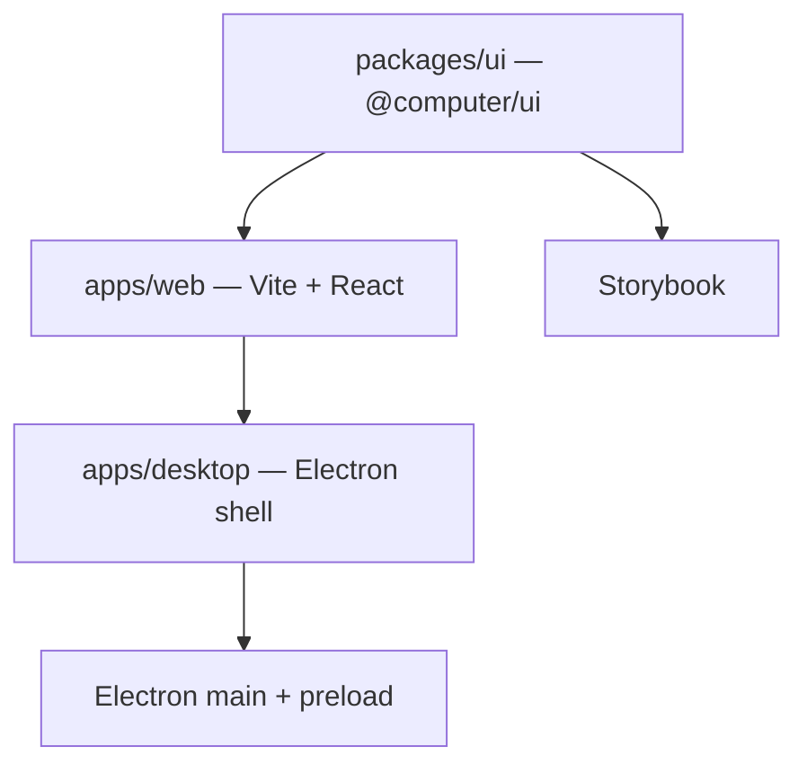

# Electron blank reboot (web + Mac + shareable UI)

Original reboot plan supplied by Tim, 2026-10-19. See the root README for the scaffold's commands and current structure.

## Decisions

- Blank start at `/Users/timcherny/Computer-app`.
- Leave `/Users/timcherny/Computer` untouched — reference only for logic Tim points at.
- Arcade stays as-is.
- Shareable components: build our library in `packages/ui` using Astryx-style patterns: a separate package, theme tokens, and a docs/catalog surface. Do not fork Astryx or adopt `@astryxdesign/core` as the product UI in this pass. Rebuild components and mirror the packaging model so others can install ours later.
- Stack: Vite 8 + React 19 (JSX) + Electron; Storybook for the component catalog.

## Scope of Astryx inspiration

- Day one: monorepo, `packages/ui`, Storybook, CSS-variable themes, clear public exports, and imports from `@computer/ui`.
- Later: full component parity, StyleX authoring pipeline, theme CLI, and MCP/agent docs. Those are a follow-on product, not this reboot.

## Architecture

- `packages/ui`: reusable components and tokens; JavaScript public API through `src/index.js`.
- `apps/web`: product web app.
- `apps/desktop`: Electron shell loading the same UI.
- Storybook: browse and document the component library.

## Theme model

- CSS custom properties on `:root` and `[data-theme]`.
- Components consume tokens rather than hardcoded colors.
- Consumers override theme variables without a fork.

## Scaffold steps

1. Create the npm workspaces monorepo at `/Users/timcherny/Computer-app`.
2. Add `packages/ui` with Button, token CSS, and Storybook.
3. Add web and desktop targets using the shared UI.
4. Provide `dev`, `dev:desktop`, `storybook`, `build`, and `build:desktop` scripts.
5. Initialize Git on `main`; no remote until requested.
6. Retarget the Computer app chat to this folder.

## Working agreement

- Rebuild UI in `packages/ui` and product screens in `apps/*`.
- Copy or adapt old Computer logic only when Tim names the area; never edit Computer.
- Publish `@computer/ui` only when Tim asks.

## Out of scope

- Porting the full Computer UI.
- Installing or adopting Astryx as the design system.
- Vercel or Electron auto-update.
- Changing Arcade or DevRev-computer.
